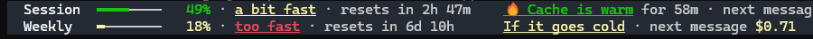
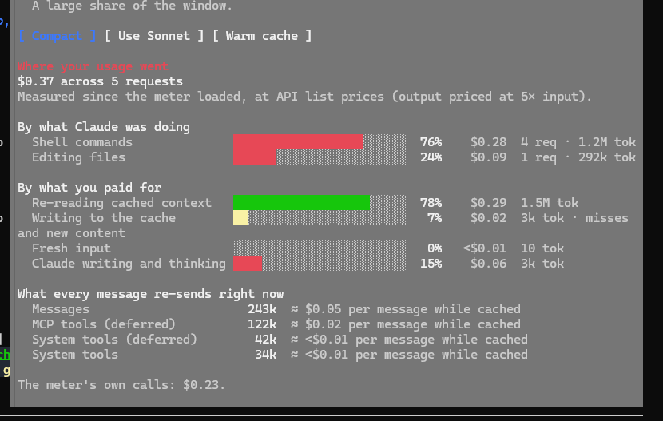
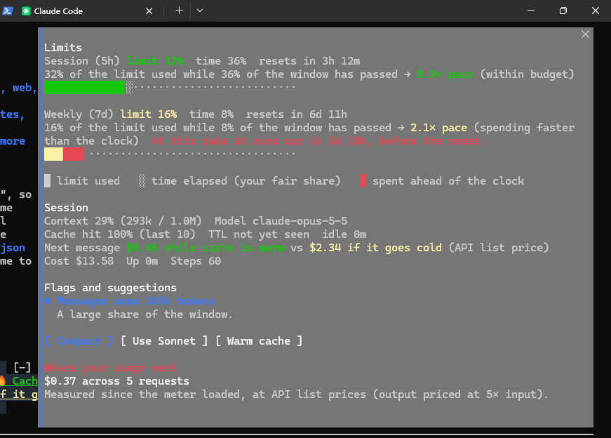

# usage-meter

A Claude Code mod that shows what your session is costing you, live, in a slim two-line band above the prompt: your session and weekly limits, whether you're burning them faster than the clock, whether the prompt cache is warm, how full the context is, and what to do about it.



## What it shows

**The band (always visible)**

| Part | What it tells you |
|---|---|
| **Session / Weekly bars** | How much of your 5-hour and 7-day limit is used, plus a pace word (`on track`, `a bit fast`, `too fast`) comparing limit used against time elapsed in the window, and when each resets. Click the pace word for the full breakdown. |
| **🔥 Cache is warm / 🧊 cold** | How long the prompt cache stays warm, what your next message costs while warm, and what it would cost if the cache goes cold. Click for details. |
| **Context %** | How full the context window is. |
| **⚠ N THINGS NEED YOU** | Appears only when something is wrong (context nearly full, cache cold on a big context, limits burning fast, or a threshold you set). Click it to see what's wrong and a one-press fix. Each item can be dismissed. |
| **More ›** | The full panel (see below). |
| **Mascot** | A baby Claude that blinks, smiles, breathes, and puts on a headband when it's reasoning hard. |
| **🎯 ●●○○○ 2/5** | Goals for the current task: Claude's own task list, or a quick plan with time estimates made from your prompt. Click for steps, time spent, time left, and journey summaries (this session / today / this week). |
| **⛽ $0.23** | What the mod itself has spent (cache warm-ups, plans). Hidden while it's free. |

**More panel**

- **Pace**: the rate you use each limit per hour/day vs. the safe max, and whether you'll run out before the reset.
- **This session**: cost, requests, cache hit rate, model.
- **Health**: anything flagged, with **Compact**, **Use Sonnet** and **Warm cache** buttons.
- **Alerts**: set your own thresholds (session limit, weekly limit, context, session spend, cold-cache message cost). Toggle each on/off and move the limit with − / +. You get a toast the moment one is crossed. Saved across sessions.
- **Where it went**: spend broken down by what Claude was doing and by token type.
- **Re-sent every message**: what each message carries along (messages, tools, system prompt) and its price.





## Install

In a Claude Code terminal session, type:

```
/plugin install usage-meter --marketplace rohit-adak/usage-meter
```

Answer `y` to add the marketplace, then pick a scope (user scope loads it in every session). This repository is private, so your GitHub account needs access to it.

### Run from a local clone (development)

```
git clone https://github.com/rohit-adak/usage-meter.git
claude --plugin-dir ./usage-meter
```

## Usage

The band appears by itself after your first reply. Beyond clicking items in it:

| Command | What it does |
|---|---|
| `/meter` | Open the More panel |
| `/meter focus` | Show the mascot's hard-work headband for 15 seconds |
| `/meter alert` | Show a sample alert for 30 seconds, to try the fix panel |

## How the numbers are worked out

- **Limits** come straight from Claude Code's rate-limit data (`five_hour`, `seven_day`).
- **Pace** = share of the limit used ÷ share of the window elapsed.
- **Costs** are estimates at API list prices (output priced at 5× input, cache reads at a tenth of input, cache writes at 1.25× for 5-minute or 2× for 1-hour). They are not your subscription bill.
- **Cache lifetime** is learned from the session (assumed 1 hour until a 5-minute expiry is seen).
- **Goal plans** come from one small Haiku call per task-like prompt (4+ words, not a slash command), costing around a tenth of a cent each. Claude's own task list replaces the plan whenever it makes one.
- Only what happens after the mod loads is counted.

## Development

```
claude plugin validate .
claude plugin test .
```

Files:

- `hooks/register.tsx`: the whole mod (hooks, band, panels)
- `types/index.d.ts`: its state contract
- `hooks/*.test.ts`: logic and rendering tests
